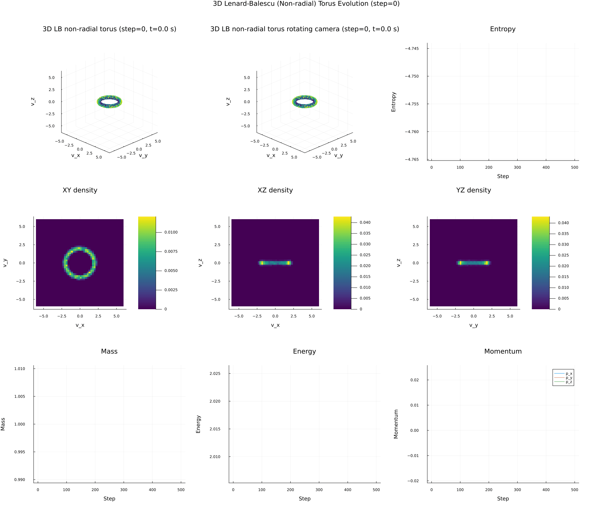

# LenardBalescu.jl

[](https://github.com/TSGut/LenardBalescu.jl/actions/workflows/tests.yml)
[](https://doi.org/10.5281/zenodo.24462246)

Julia companion code for 3D and 2D multi-threaded plasma simulations using particle-in-cell methods with **Lenard-Balescu** or **Landau** collision operators.

The method is described in *A particle method for the Lenard-Balescu equation* ([arXiv: TODO](https://arxiv.org/abs/TODO)).

## Installation

```julia
using Pkg
Pkg.add(url="https://github.com/TSGut/LenardBalescu.jl")
```

## Quick Start

```julia
using LenardBalescu

par = SetParam()          # default parameters
result = run_simulation(; par, use_lenard_balescu=true, verbose=1)
```

## Random Batch Method (RBM)

`run_simulation` supports random-batch acceleration through `par.batchsize` meaning that at each time step, particles are randomly repartitioned into balanced batches targeting (but not necessarily exactly matching) the batch size. Interactions for that timestep are then only computed within batches.

- `par.batchsize = 0` (also `1` or `>= N`): batching disabled, full interactions used (default).
- `2 <= par.batchsize < N`: random batching enabled, targeting batches of size `par.batchsize`.

### Pre-made Examples

Various 2D and 3D Landau and Lenard-Balescu examples, including BKW, double-ring and toroidal initial states, are in `examples/`.

To run an example from a local checkout:

```bash
git clone https://github.com/TSGut/LenardBalescu.jl.git
cd LenardBalescu.jl
julia --project=. -e 'using Pkg; Pkg.instantiate()'
julia --project=. --threads=auto examples/2D_run_lenardbalescu_demo_bkw.jl
```

Edit the parameters in the script before running; outputs are written under `examples/output/`.

<p align="center">
  
</p>

## Benchmarking Examples

The `benchmarks/` directory contains scripts for benchmarking and profiling the performance of the Lenard-Balescu and Landau collision simulations in both 2D and 3D:

## License

MIT — see [LICENSE](LICENSE).
